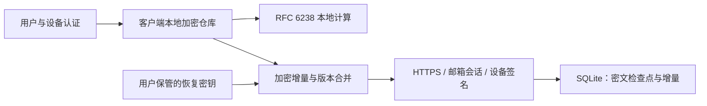

# 架构与协议 v1

## 组件

Flutter 四端共享业务层。平台插件负责系统认证、安全存储、文件选择和相机；原生桥负责敏感剪贴板、隐私遮罩及系统锁定事件。Python HTTP 服务通过 SQLite 事务管理账号、设备、加密检查点及增量变更，SMTP 只发送登录验证码。



## 密钥层次

- **本机数据密钥**：操作系统随机源生成 32 字节，AES-256-GCM 加密整个本机状态，包括同步会话和云密钥。系统模式存入平台安全存储；密码模式使用 PBKDF2-HMAC-SHA256 派生密钥加密包装。本机数据与云数据使用不同密钥。
- **云主密钥**：随机 32 字节，客户端加密 TOTP 记录及分组、标签、收藏等元数据。
- **云授权签名种子**：随机 32 字节，Ed25519，用于证明新会话持有解密材料。公钥由服务端保存，私钥仅位于本机密文、恢复包装或设备间加密交付内容中。
- **恢复密钥**：256 位随机数加 SHA-256 前 4 字节校验码，以 Base32 分组展示。直接作为高熵包装密钥，无低熵用户口令。它包装云主密钥及授权签名种子。
- **备份密码**：与以上凭据独立。PBKDF2-HMAC-SHA256、600,000 轮、16 字节随机盐，导出 256 位 AES-GCM 密钥。至少 12 字符。版本 1 严格固定工作因子，拒绝攻击者指定超大参数。

所有 AES-GCM 使用随机 12 字节 nonce、16 字节认证标签。AAD 是 `six-tick:v1:<purpose>`。purpose 将账号 ID、加密世代和使用场景绑定到密文，阻止不同账号、备份和云数据之间替换。

```json
{
  "v": 1,
  "purpose": "vault:<accountId>:<epoch>",
  "nonce": "base64",
  "ciphertext": "base64",
  "tag": "base64"
}
```

密码文件额外包含 `format=six-tick`、`version=1`、`kdf=PBKDF2-SHA256`、`iterations=600000`、`salt` 与 `box`。本地格式为 `six-tick-local`，密码包装和内容分别使用 `local-key`、`local-vault` 场景。

## 本地提交

客户端保存先构建新不可变文档，再加密写入同目录 `.pending` 文件并 flush，最后替换正式文件。只有写入成功才更新界面状态。写入失败保留旧文档；临时文件只含密文。

本机写入通过队列串行化。同步网络请求不占用该队列。网络返回后在队列中合并最新本机修改，因此服务器超时不阻止离线添加，上传中的本机编辑也不会被旧快照覆盖。锁定会增加会话世代并丢弃内存中的仓库、云会话与密钥引用；过期异步响应不能重新打开界面。

## 变更与冲突

每次修改生成 UUID 变更，包含记录 ID、类型、父变更 ID 集合、字段补丁与删除标记。父节点只允许属于同一记录。创建节点持有完整不可变 TOTP 参数；后续补丁只能改变标签、分组、收藏等可编辑字段。

合并为按变更 ID 的集合并集，相同 ID 不同内容视为损坏。每个字段采用因果关系的多值寄存器：

1. 有因果先后时，后继值替代祖先值。
2. 不同字段同时修改，各自保留最新值。
3. 同字段并发不同值保留所有候选，界面显示冲突，用户选择会创建覆盖当前分支的新变更。
4. 任意删除标记使该记录永久不可见，后续导入使用新记录 ID。
5. 分组删除不删除账号；失效分组引用显示为未分组。

解密后校验类型、参数、同记录父节点、根节点唯一性、DAG 无环与变更 ID 一致性。损坏数据不能替换本地仓库。上限 50,000 个变更、备份 10,000 个条目，用于限制不可信输入资源消耗；长期使用需规划有审计的因果历史压缩，不能直接丢弃删除标记。

## 增量同步

每个云仓库有 `epoch`、单调 `revision`、检查点版本 `baseRevision`。服务端不读取变更内容。

- 新仓库上传完整加密检查点，revision=1。
- 客户端记录已确认变更 ID 集合，按已知 revision 拉取新增密文块。
- `POST /v1/vault/pull` 返回必要时的检查点与之后的顺序密文增量。没有新内容时不传整个仓库。
- 客户端解密、校验连续版本并合并，先落盘，再仅上传尚未确认的变更。
- `PUT /v1/vault` 使用期望 revision 的 CAS。冲突后重新拉取合并，最多连续尝试四次，随后保留待同步状态。
- 每次提交带随机 `requestId`。同一 ID 与相同载荷返回原结果，不重复创建版本；不同载荷重用 ID 被拒绝。
- 响应丢失后客户端可重新拉取；已存在的操作 ID 自动去重。
- 前台解锁时每四秒检查更新；本地编辑防抖 300ms；启动、前台恢复和手动操作触发同步。后台不常驻生成验证码。
- 恢复密钥轮换上传新世代的完整加密检查点，保留全部删除及因果历史，删除服务端旧世代增量并撤销其他设备会话。

## 设备授权与配对

邮箱验证码验证产生 30 天登录会话及随机一次性会话挑战。邮箱会话能获取恢复包装，但不能读取仓库密文增量。

设备使用 Ed25519 对以下 UTF-8 消息签名：

`six-tick:authorize:v1:<accountId>:<sessionChallenge>:<deviceId>:<epoch>`

服务端校验后把设备绑定到会话。每个仓库访问都重新检查设备撤销状态与世代。撤销删除相关会话；再接入必须重新验证邮箱并授权。

配对使用新设备临时 X25519 公钥。配对码携带请求 ID 和该公钥，已有设备必须核对服务器返回的公钥与用户传入的配对码一致。核对码为完整配对码 SHA-256 的前 8 个十六进制字符，两端由用户比较。已有设备重新认证并明确批准后，用临时 X25519 + HKDF-SHA256 派生 AES-GCM 传输密钥，交付云密钥材料。新设备凭该材料完成独立的签名授权，成功持久化后消费请求。

请求五分钟过期，批准只允许一次，消费后删除交付密文。原始配对私钥只存活于新设备当前界面的内存。

## HTTP 接口

所有业务请求使用 JSON；会话使用 `Authorization: Bearer <token>`；响应禁止缓存，不支持跨站浏览器调用和 URL 凭据。

| 方法与路径 | 授权 | 用途 |
|---|---|---|
| GET `/health` | 无 | 进程和协议健康状态 |
| POST `/v1/auth/request` | 限流 | 发送登录验证码 |
| POST `/v1/auth/verify` | 验证码 | 生成账号会话和挑战 |
| GET `/v1/vault/info` | 邮箱会话 | 查询公钥、世代、恢复包装 |
| POST `/v1/vault/create` | 新鲜会话 + 密钥证明 | 创建首个仓库 |
| POST `/v1/devices/authorize` | 新鲜会话 + 密钥证明 | 授权当前设备 |
| GET `/v1/vault` | 授权设备 | 完整检查点与全部后续增量 |
| POST `/v1/vault/pull` | 授权设备 | 按 epoch/revision 增量拉取 |
| PUT `/v1/vault` | 授权设备 | CAS 加密增量提交 |
| POST `/v1/vault/rotate` | 授权设备 + 新鲜会话 | 轮换恢复与云密钥 |
| GET `/v1/devices` | 授权设备 | 列出设备 |
| POST `/v1/devices/rename` | 授权设备 | 重命名设备 |
| POST `/v1/devices/revoke` | 授权设备 + 新鲜会话 | 撤销其他设备 |
| POST `/v1/pairings` | 新鲜邮箱会话 | 创建配对请求 |
| GET `/v1/pairings/<id>` | 请求方或授权设备 | 读取请求信息或加密交付结果 |
| PUT `/v1/pairings/<id>` | 授权设备 | 提交一次加密交付 |
| DELETE `/v1/pairings/<id>` | 请求方会话 | 消费或取消请求 |
| POST `/v1/vault/reset` | 新鲜会话 + 邮箱确认 + CAS | 删除无法恢复的旧云仓库 |
| POST `/v1/account/delete` | 新鲜会话 + 邮箱确认 | 注销并删除数据 |

“新鲜”指邮箱验证距现在不超过 10 分钟。客户端对敏感操作另做本机认证。会话 token 与邮箱验证码只以服务端 pepper 的 HMAC 摘要落库。生产 pepper 不得与数据库共同公开。

常见错误：401 `unauthorized` / `invalid_code`；403 `device_revoked` / `reauthentication_required`；409 `sync_conflict` / `idempotency_conflict`；410 `pairing_expired`；429 `rate_limited`；503 `mail_unavailable`。
