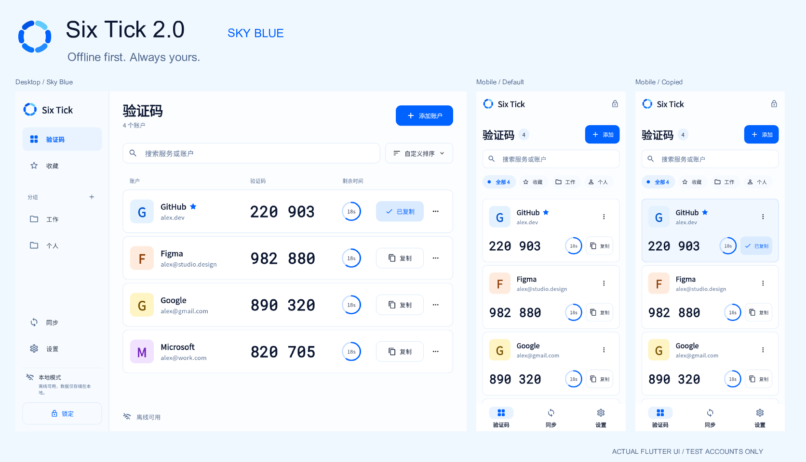
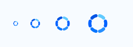

# Six Tick · 晴空蓝 UI

以本次确认的 [晴空蓝参考图](reference-sky-blue.png) 为最终视觉标准：晴空蓝强调色、近白底色、深蓝黑文字、浅蓝描边与无底板六刻度时间环。手机、桌面、浅深色与中英文使用统一的 Flutter 设计系统。下方是应用实际渲染结果，包含桌面、手机默认态和手机复制成功态。



## 页面与交互

| 设计目标 | 应用中的实现 |
| --- | --- |
| 晴空蓝主色与六刻度时间环 | 全局浅深色主题、品牌标志和四平台启动图标统一更新 |
| 桌面侧栏 | 验证码、收藏、单层分组；底部提供同步、设置、本地／同步状态和锁定；内容较多或字体较大时可滚动 |
| 桌面验证码列表 | 标题与账号数、添加账户、搜索、自定义排序，账号／验证码／剩余时间列标题，横向账号行；底部显示离线可用 |
| 手机布局 | 品牌与锁定、标题与数量徽标、添加、搜索、全部／收藏／分组筛选；验证码、同步、设置三项底部导航 |
| 账号识别 | 离线首字母头像、服务名、账号标识、收藏星标和更多菜单；头像颜色离线计算 |
| 取码 | 深色大号等宽数字、3+3／4+4 分组、带秒单位的蓝色倒计时环、带文字的复制按钮 |
| 复制成功 | 仅成功写入剪贴板后显示勾选和「已复制」，手机当前卡片变浅蓝，桌面仅高亮复制按钮，2 秒后复原；不弹出遮挡列表的成功提示条 |
| 自定义排序 | 菜单可选自定义、名称排序、收藏优先；自定义对话框支持拖动和上／下箭头，明确保存或取消 |
| 安全与备份 | 入口位于设置页，保留应用锁、自动锁定、加密备份／恢复、剪贴板保护与原有认证流程 |

界面中所有入口使用实际功能。设计板中的「2.0」沿用参考图标题，应用名称和发布版本保持项目原值。首次安装为空仓库；预览中的工作／个人分组与示例服务仅存在于截图测试数据，不会添加到用户仓库。

## 视觉与响应式规范

| 设计变量 | 浅色 | 深色 |
| --- | --- | --- |
| 页面底色 | `#FCFDFF` | `#0C1424` |
| 卡片 | `#FFFFFF` | `#131F33` |
| 侧栏 | `#F7FBFF` | `#101B2C` |
| 主要文字 | `#0B1630` | `#EDF4FF` |
| 次要文字 | `#536B91` | `#A9BDDB` |
| 强调色 | `#0062FF` | `#78B5FF` |
| 浅强调底色 | `#E8F3FF` | `#1D3454` |
| 描边 | `#DBE9FA` | `#304762` |
| 警告／即将更新 | `#895916` | `#EDC178` |
| 错误／危险操作 | `#B33C34` | `#FFB4AB` |

- 系统字体，数字使用 tabular figures 保持等宽；验证码手机 32px／桌面 36px，使用系统等宽字体；桌面标题 32px、手机标题 28px、服务名 18px、账号标识 14px。过窄时仅数字区域按比例缩小，完整显示所有数字；正文尊重系统字体缩放。
- 卡片、输入框与按钮圆角 12px。核心间距使用 4／8／12／16／24／32px，账号行按参考图使用 18px 手机／22px 桌面垂直留白与 56px 首字母头像；交互区域至少 48px。
- 840px 为侧栏与底部导航分界；侧栏 220px，主内容最大宽度 1120px，桌面内容边距 32px，手机 16px。账号行和列标题使用同一列布局组件；可用内部宽度达到 620px 且字号适宜时采用横向列，否则采用上下布局。
- 手机卡片第一行显示身份与菜单，第二行显示验证码、倒计时与复制。大字体下验证码与倒计时／复制区分行，避免截断操作。
- 倒计时按每条账号真实周期计算；最后 5 秒用琥珀色和文字提示，读屏不会逐秒播报。复制时重新取当前周期验证码，避免周期交界时复制旧码。
- 复制高亮、导航与键盘定位使用 180ms 过渡；尊重减少动态效果。表单窄屏底部对齐、桌面居中、最大宽度 560px，内容与按钮可滚动，适应软键盘。
- 首次仓库、空收藏、空分组、搜索无结果保持不同文案与操作；错误、离线和危险操作同时提供文字说明。隐私遮罩隔离底层语义、焦点和指针，锁定时关闭敏感弹窗。

## 功能与兼容性

- 搜索服务／账号与收藏／分组筛选组合生效。桌面 Ctrl/Cmd+F 返回账号页并聚焦搜索，提交后进入列表，↑/↓ 选择，Enter 复制；键盘定位有可见指示。
- 收藏通过账号菜单切换，已收藏项在服务名旁显示蓝色星标。分组管理在桌面「分组」标题旁，手机筛选栏尾部；手机排序入口也在筛选栏尾部，支持横向滚动访问。
- 排序采用本机加密偏好 `accountSort`（`custom`／`name`／`favorites`）和 `accountOrder`（账号 ID 列表），随本机仓库保存与解锁恢复。旧仓库缺少字段时采用默认自定义顺序。排序不修改同步文档，不改变密钥、账号字段或云协议。
- 已删除账号 ID 被忽略，新账号追加到自定义序列末尾；名称排序与收藏优先不会覆盖手动顺序。保存失败保持原偏好，取消对话框不写入。
- 首次使用、添加／确认、相机扫码、图片导入、多码选择、编辑、分组管理、迁移二维码、同步冲突、邮箱验证、设备配对、恢复密钥、备份、设置及帮助使用同一设计系统。
- 默认时钟仍来自设备；`HomeScreen.epochSeconds` 仅作为可选测试注入点，便于检查跨周期复制和生成稳定预览，不提供用户时间偏移设置。

## 品牌资源与可重复生成

源文件为 `client/assets/brand/six-tick.svg`：1024 画布、中心 `(512,512)`、半径 260、线宽 104；从 −77° 起，每段扫过 34°，六段间隔 60°，圆润端点。右上段为亮天蓝 `#60CAFF`，其余段由 `#0062FF`、`#268FFF`、`#0875FF`、`#0054E5` 组成。应用内 `BrandMark` 以同一几何比例紧凑取景，显示无底板圆环；启动器图标置于浅白底 `#F7FBFF`，iOS 输出不透明完整方形，由系统裁切。

从 `client/` 目录运行：

```bash
dart run tool/generate_icons.dart
flutter test test/brand_assets_test.dart
```

使用已有 `image` 依赖，输出 iOS 无透明通道的完整尺寸集、macOS 16–1024px、Windows 七尺寸 ICO、Android 传统密度／自适应／单色图标，以及启动图片、品牌 PNG 和小尺寸检查图。Android 前景位于 66dp 安全圆内；iOS 和 Android 启动底色同时适配浅深色。



导出器面向当前六段圆弧结构；修改几何结构时需同步应用内绘制参数，并重新校验平台裁切。

## 预览与验证

| 页面 | 文件 |
| --- | --- |
| 手机默认／复制成功 | [默认](phone-codes-light.png) · [已复制](phone-copied-light.png) |
| 桌面默认／复制成功 | [默认](desktop-codes-light.png) · [已复制](desktop-copied-light.png) |
| 深色 | [手机](phone-codes-dark.png) · [桌面](desktop-codes-dark.png) |
| 首次使用／添加 | [欢迎](phone-welcome.png) · [添加账号](phone-add.png) |
| 同步／安全／设置 | [同步](phone-sync.png) · [安全与备份](phone-security.png) · [设置](phone-settings.png) |

预览由真实 Flutter 组件导出，使用临时测试仓库与固定测试时间；复制成功图片通过实际点击生成并断言成功状态。用于字体渲染的 Noto Sans CJK SC Regular 和 Roboto Mono 仅供测试加载，不进入应用运行时；真实系统字形可能略有差异。

准备本地字体目录，分别命名 `NotoSansSC.ttf`（支持 OTF 内容）和 `RobotoMono.ttf`，执行：

```bash
flutter test tool/ui_preview_test.dart \
  --dart-define=PREVIEW_FONT_DIR=/absolute/path/to/preview-fonts
dart run tool/design_overview.dart
```

验证使用 Flutter 3.35.7 / Dart 3.9.2。最终晴空蓝版 `flutter analyze --no-pub` 无问题，完整客户端测试 74 项全部通过；实际 Flutter 页面截图导出通过。Android／iOS 13 个 XML 资源解析及 `git diff --check` 通过。

复现命令：

```bash
flutter analyze
flutter test --dart-define=ALLOW_INSECURE_LOCALHOST=true --reporter expanded
```

回归覆盖 360／390／440／1280px、最小桌面 440×600、浅深色、中英文、200% 字体、长名称、6／8 位码、自定义周期、键盘遮挡、搜索／收藏／分组、三项导航与设置中的安全入口、识别确认保存／取消、排序保存／取消／失败／重启、复制高亮与跨周期复制、隐私语义和锁定弹窗清理。图标检查包含尺寸、iOS 不透明、Android 裁切区与单色引用、Windows 多尺寸；主要文字对比度满足 AA。

原生平台构建和相机、系统认证、启动器裁切等实机验收需要对应平台环境。本次不发布应用；后续提交／PR 可通过现有 CI 构建四端。
